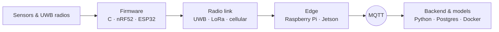

# Muhammad Zain Mian

**Embedded systems and IoT.** I build systems where hardware, firmware and software meet:
indoor positioning with ultra-wideband radios, weather stations that report over LoRa,
and computer vision on edge GPUs. I like work I can test on a bench and then deploy in the field.

### Currently

- Improving UWB ranging accuracy: antenna-delay calibration, per-anchor bias maps and first-path (CIR) detection in multipath
- Building rain and wind forecasts for a single hyperlocal weather station

### Featured

| Project | What it does | Built with |
|---|---|---|
| [**uwb_tdma_twr**](https://github.com/zainnmiann/uwb_tdma_twr) | One UWB ranging firmware for two platforms. Any DWM1001 or ESP32 board can be a tag or an anchor in the same TDMA DS-TWR network, verified on hardware | C · nRF52832 · ESP32 · DW1000 |
| [**dwm1001-uwb-dstwr-firmware**](https://github.com/zainnmiann/dwm1001-uwb-dstwr-firmware) | RTLS firmware for DWM1001-DEV: initiator-driven fixed-slot DS-TWR, up to 12 anchors and 32 tags, ~7.2 Hz per tag measured on a 10 × 9 schedule, plus host simulator and Pi bridge | C · nRF5 SDK · Python |
| [**weather_lora_link**](https://github.com/zainnmiann/weather_lora_link) | Solar weather station to gateway over LoRa P2P, with HMAC-signed frames, a relay hop and a cellular uplink. Range-tested in the field | C++ · ESP32 · Wio-E5 · MQTT |
| [**jetson-human-detection**](https://github.com/zainnmiann/jetson-human-detection) | Real-time YOLO11 person detection on a Jetson AGX Orin running Yocto, with MP4 recording and a live web view | Python · PyTorch · OpenCV · systemd |
| [**uwb_bridge**](https://github.com/zainnmiann/uwb_bridge) | Raspberry Pi service that streams UWB ranges from UART to MQTT, with framing, checksums and auto-recovery | Python · MQTT · systemd |
| [**esp32_uwb_tdma_twr**](https://github.com/zainnmiann/esp32_uwb_tdma_twr) | ESP32 UWB Pro port of the multi-tag, multi-anchor ranging protocol | C/C++ · PlatformIO |
| [**WeatherStation**](https://github.com/zainnmiann/WeatherStation) | ESP32 station: BME280, AS3935 lightning detector, wind/rain kit, soil moisture | Arduino · ESP32 |
| [**gta4-macos**](https://github.com/zainnmiann/gta4-macos) | How I got GTA IV running on an Apple Silicon Mac | Wine · macOS |

### Toolbox

**Languages**&nbsp;

**Embedded**&nbsp;

**Edge & infra**&nbsp;

**ML & vision**&nbsp;

